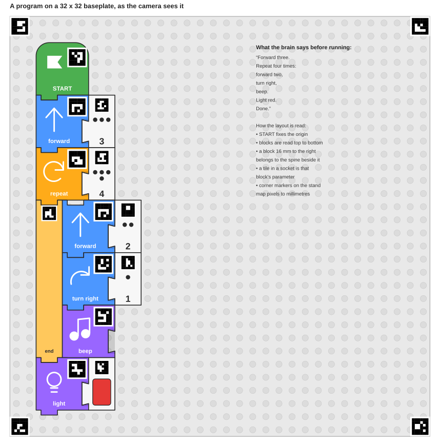

# Tangible blocks for LEGO robots

A screen-free way for a child to program a LEGO MINDSTORMS / SPIKE robot by
snapping together 3D-printed blocks, then pressing a big RUN button.

> Working title only. Rename the repo and this file once the name is settled.

## The idea in one paragraph

LEGO's own apps program the robot with Scratch-style blocks on a tablet or
laptop. We keep the blocks but make them physical: each block is a 3D-printed
tile with an icon on top that snaps to its neighbours (and to a LEGO baseplate).
A small "brain" (Raspberry Pi Zero 2 W) reads the arrangement of blocks,
compiles it into a program, and sends it to the LEGO hub over Bluetooth. The
child never touches a screen; feedback comes from lights, sounds and the robot
itself.



## Status

Concept settled; first code and the paper prototype are in progress. Target
robot: **LEGO SPIKE Prime + Expansion Set** running Pybricks.

## Documents

| File | What it answers |
| --- | --- |
| [docs/01-vision.md](docs/01-vision.md) | Who this is for, what success looks like, design principles, what already exists |
| [docs/02-reading-the-program.md](docs/02-reading-the-program.md) | The core technical question: how does the brain know which blocks are where? Four options compared, one recommended |
| [docs/03-interaction-design.md](docs/03-interaction-design.md) | What a session feels like for the child, block vocabulary and grammar, feedback without a screen, error handling |
| [docs/04-architecture.md](docs/04-architecture.md) | Brain hardware, software pipeline, robot driver layer (Pybricks / ev3dev), block encoding, printing plan |
| [docs/05-roadmap.md](docs/05-roadmap.md) | Phases, what to build first, and the decisions that are still open |
| [docs/decisions.md](docs/decisions.md) | Decision log: SPIKE Prime is the target robot, camera is the reader, blocks are passive prints |
| [docs/06-robot-mapping.md](docs/06-robot-mapping.md) | Which LEGO kits work, the standard robot build, and how every block becomes a motor or sensor call |

## What exists today

| Piece | Where | State |
| --- | --- | --- |
| Block vocabulary and marker ids | `blocks/vocabulary.json` | version 1, drives everything below |
| Layout parser: markers on the board → program, child-friendly errors | `brain/language/` | tested (`tests/test_layout.py`) |
| Read-aloud phrases and voice-clip keys | `brain/language/speech.py` | tested |
| Camera reader: ArUco detection and pixel → mm mapping | `brain/reader/` | tested on synthetic images (`tests/test_reader_synthetic.py`) |
| Robot simulator | `brain/drivers/simulator.py` | tested |
| Bluetooth driver to the hub | `brain/drivers/pybricks_ble.py` | written from the Pybricks protocol docs, not yet run against a hub |
| Hub interpreter for SPIKE Prime (Pybricks MicroPython) | `hub/pybricks/interpreter.py` | written, not yet run on a hub |
| Brain main loop (buttons, ring, speaker, state machine) | `brain/main.py` | runs on a laptop with `--image` and `--simulate` |
| Printable 1:1 paper tiles for the first play test | `docs/paper/paper-blocks.pdf` | ready to print |
| Concept sketches | `docs/images/` | generated by `tools/block_sketches.py` |

```
pip install -r requirements.txt
python -m pytest                                 # language + synthetic camera tests
python tools/paper_tiles.py                      # regenerate the paper tiles (PDF needs node + playwright)
python -m brain.main --image photo.jpg --simulate   # read a photo of the board, print what the robot would do
```

## Repository layout

```
docs/            concept, design, decisions, printable paper tiles
blocks/          block vocabulary and marker id table (single source of truth)
brain/           Python that runs on the Raspberry Pi
  reader/        camera capture, ArUco detection, pixel → mm grid mapping
  language/      vocabulary, layout parser, IR, speech
  drivers/       hub link over BLE, simulator
hub/pybricks/    MicroPython interpreter that runs on the SPIKE Prime hub
tools/           sketch and paper-tile generators
tests/           pytest suite
hardware/        (to come) 3D-printable blocks, brain enclosure, camera stand
```
