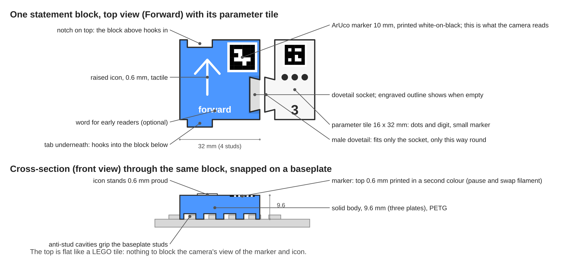
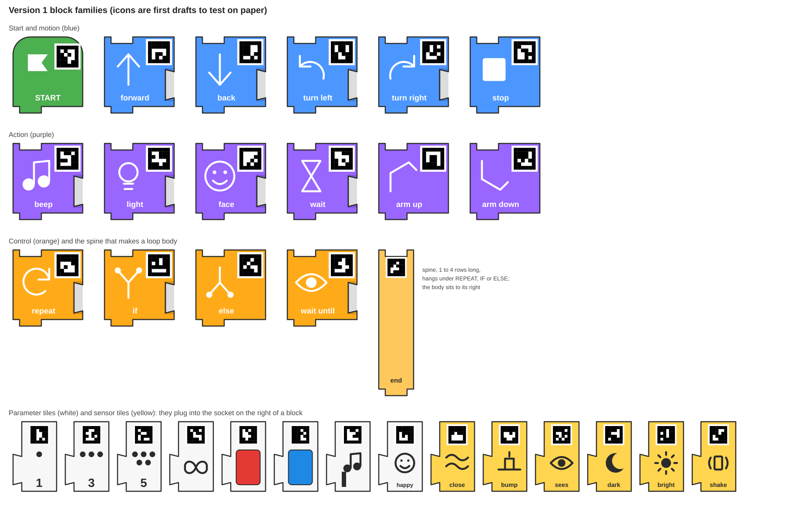
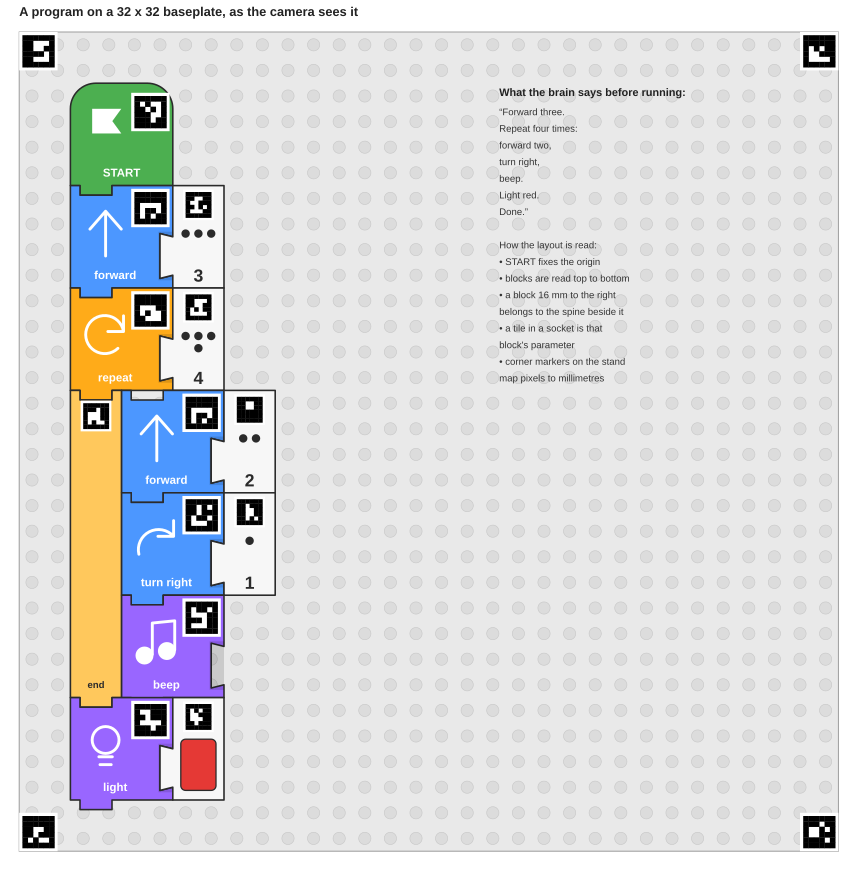

# 03 · Interaction design

This is the part to get right before printing anything. Everything here can be
tested with paper tiles and a parent pretending to be the robot.

## A session, step by step

1. **Switch on.** Child presses the power button on the brain. LED ring spins
   while it boots (target under 30 s, ideally the brain just stays on a power
   bank). When the brain has found the hub over Bluetooth the ring turns solid
   blue and the hub's LED matrix shows a smiley.
2. **Build.** Child snaps blocks onto the baseplate under the camera, starting
   with the green START block in the top-left corner. Blocks go downwards in a
   column; a REPEAT or IF block opens an indented column to its right.
3. **Run.** Child presses the big green RUN button.
   - Ring turns white for the photo (acts as a flash), then yellow while
     thinking.
   - Brain **reads the program aloud**: "Forward 3. Turn right. Repeat 2 times:
     forward 1, beep. Done." Reading aloud is the debugger. A child hears a
     missing or wrong block long before the robot shows it.
   - Ring turns green; robot executes. The hub matrix shows the number of the
     block currently running.
4. **Stop.** Red STOP button halts the robot immediately, from any state.
5. **Step.** Yellow STEP button runs one block per press. The brain says the
   block name as it runs it. This is how loops click for a seven-year-old.
6. **Repeat without re-reading.** Pressing RUN again within a few seconds of a
   completed run re-runs the last program without a new photo (fast loop for
   "let's see that again").

## Feedback vocabulary (no screen)

| Channel | Used for |
| --- | --- |
| 16-LED ring on the brain | state: booting, ready, photographing, thinking, running, error (red blink) |
| Speaker on the brain | read-back of the program, block names in STEP mode, error messages in plain words, little fanfare on completion |
| Hub 5×5 matrix | current block number while running; a face when idle; "X" on error |
| Hub status light | mirrors brain ring colour so both ends agree |
| Robot itself | the real result |

Voice clips can be the parent's own recordings, one short clip per block and per
message. This is warmer than text-to-speech, works offline, costs no CPU, and
is a fun afternoon to record. Numbers and composed sentences come from
concatenating clips.

## Error handling in words a child understands

The brain never says "parse error". It says where and what, in order of
likelihood:

- "I can't find the START block. Put the green block in the corner."
- "There is a gap after block 4." (block not snapped on the grid)
- "The REPEAT block on row 3 has nothing inside it."
- "I see a number tile with no block next to it."
- "A hand is in the picture. Try again." (markers partially occluded)
- "The robot is not answering. Is it switched on?"

Rule: one sentence, says what to do, never blames the child.

## Block families

Version 1 vocabulary. Icons, not words, on every block; a word can be embossed
underneath for early readers.

### Start (hat block, green, one per program)
- **START** — anchors the program; the camera uses it as the origin.

### Motion (blue)
- **Forward**, **Backward** — parameter: distance tile 1 to 5 (robot lengths)
- **Turn left**, **Turn right** — parameter: 1 = 90°, or quarter-turn tiles
- **Stop moving**

### Action (purple)
- **Beep** (parameter: note tile low / mid / high)
- **Light** (parameter: colour tile)
- **Face** (parameter: expression tile: happy, surprised, sleepy)
- **Wait** (parameter: seconds tile 1 to 5)
- **Arm up / Arm down** (third motor, for grabber builds)

### Control (orange)
- **Repeat N** — opens an indented column; parameter: count tile 2 to 9, or
  the infinity tile for forever
- **If sensor** — opens an indented column; parameter: a sensor tile
- **Else** — optional, directly below the If column
- **Wait until sensor** — parameter: a sensor tile

### Sensor tiles (yellow, used as parameters, not as statements)
- **Sees something close** (distance sensor)
- **Sees colour** (with a colour sub-tile)
- **Bumped** (force sensor)
- **Hub shaken / tilted**
- **Dark** / **Bright**

### Parameter tiles (white, small)
- **Number** 1 to 9 as dots and digit
- **Colour** red, green, blue, yellow, white
- **Infinity**

## Grammar enforced by shape

- Statement blocks are 4×4 studs (32 × 32 mm, 9.6 mm tall) with a notch on
  top and a matching tab underneath, offset to the left as in Scratch. They
  only stack vertically, one way up.
- The top face is flat like a LEGO tile: a 10 mm marker in the top-right
  corner, a raised icon, and an optional word along the bottom. Underneath are
  anti-studs so the block grips the baseplate.
- START has a rounded top and no notch, so nothing can go above it. It has no
  socket, so nothing can be plugged into it.
- Parameter tiles are 2×4 studs (16 × 32 mm) with a male dovetail on the left
  that only fits the socket on the **right** edge of a statement block. A
  block without a socket cannot take a parameter; a block with a socket has an
  engraved outline so an empty one is visible at a glance.
- REPEAT and IF are ordinary 32 mm head blocks. Below them hangs a **spine**:
  a 16 mm wide bar, printed in lengths of 1 to 4 rows, with the same notch and
  tab so the main column continues underneath it. The loop body is whatever
  sits in the column immediately to the right of the spine. The spine's foot
  says "end", so the child can see where the loop stops.
- Nesting is therefore 16 mm (2 studs) of indentation per level, exactly the
  spine width. A spine can carry another REPEAT, whose own spine indents a
  further 16 mm.

## Program layout on the baseplate

A 32×32 baseplate (256 mm square) gives 8 rows of 32 mm. The main column sits
one stud in from the left edge; a block plus its parameter tile is 48 mm wide,
and each nesting level adds 16 mm. Three levels of nesting plus parameters use
under half the plate width, which leaves room for a second program column later
(for example a "when bumped" event handler). The four corner markers belong to
the camera stand, not to the program; they let the brain map pixels to
millimetres however the camera is seated.

## Things to test with paper first

- Does the child understand that the program runs top-to-bottom? (Cubetto
  users do by age 4.)
- Do number tiles on the right feel natural, or should distance be expressed by
  repeating Forward blocks? (Younger: repeat the block. Older: number tile.)
- Is the L-bracket for REPEAT understood, or is a separate END block clearer?
- Which icons are guessed correctly without explanation?
- How long before the child wants a sensor? That sets the version 2 date.
